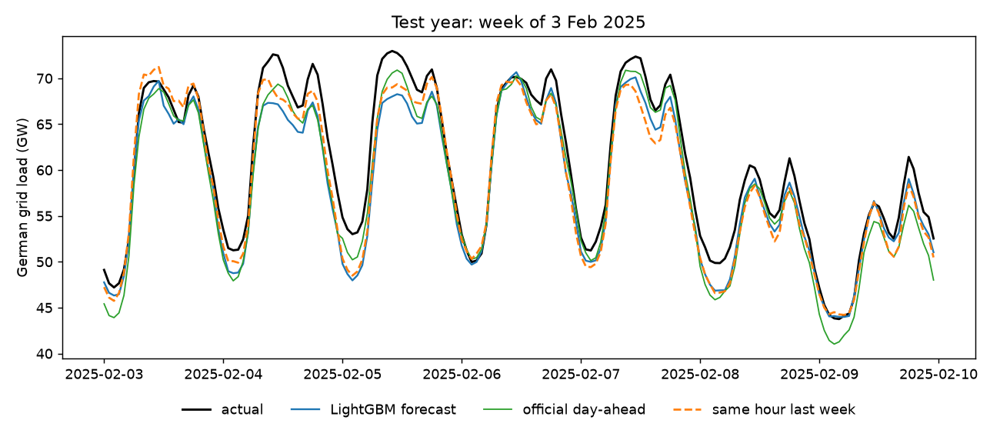
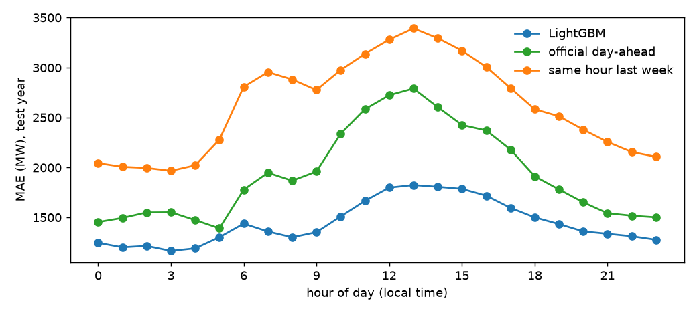
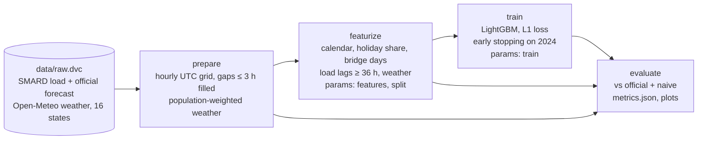

# dvc-reproducible-pipeline

Day-ahead forecast of **German electricity demand** as a fully reproducible **DVC pipeline**. Seven years of hourly grid load from SMARD (Bundesnetzagentur) and weather for all 16 federal states are versioned with DVC; four stages (prepare → featurize → train → evaluate) are wired in `dvc.yaml` with their params, metrics and plots; experiments are run and compared with `dvc exp`; and on every pull request a **CML** bot reruns the pipeline and comments the metrics diff.

[](https://github.com/abhisheklakhani-it/dvc-reproducible-pipeline/actions/workflows/ci.yml)


```console
$ git clone https://github.com/abhisheklakhani-it/dvc-reproducible-pipeline && cd dvc-reproducible-pipeline
$ uv sync && uv run dvc pull          # raw data + cached outputs from the public DVC remote
$ uv run dvc repro -f                 # rebuild every stage from the raw data: ~30 s on an M2 MacBook Air
val: model MAE 1431 MW (2.76%), official 1963 MW, last week 2656 MW
test: model MAE 1446 MW (2.73%), official 1933 MW, last week 2616 MW
$ git status                          # nothing changed: same metrics, same plots, byte for byte
```

## Results

Test year 2025 (8,760 hours), never used to choose anything. Model and baselines are scored on exactly the same hours. Raw numbers: [`reports/metrics.json`](reports/metrics.json).

| Forecast | MAE | MAPE | RMSE |
|---|---|---|---|
| **LightGBM (this repo)** | **1,446 MW** | **2.73 %** | **1,859 MW** |
| Grid operators' official day-ahead forecast (SMARD) | 1,933 MW | 3.71 % | 2,462 MW |
| Same hour last week (seasonal naive) | 2,616 MW | 4.99 % | 3,945 MW |

German demand averages about 53 GW, so 1,446 MW is the size of one large power plant. The model cuts the naive error by 45 %.

**About the official forecast:** this is *not* a fair comparison, and the gap should be read as an upper bound. The model gets the *observed* weather of the target day; the grid operators only had a weather forecast when they published theirs. A real deployment would feed in a weather forecast and lose part of the lead. The official forecast is there as a sanity check that the model is in a realistic range, not as a claim to beat it.





## The DVC side

**Versioned data.** `data/raw/` (load, official forecast, weather, 40 MB) is tracked by `data/raw.dvc`; git stores only its hash. The raw data was downloaded once by `python -m gridload.download`; the pipeline never calls an API, so `dvc repro` gives the same result even if SMARD revises old numbers. Adding the official forecast later changed `data/raw.dvc` in [one commit](https://github.com/abhisheklakhani-it/dvc-reproducible-pipeline/commits/main/data/raw.dvc), which is the point: every model version can be traced to the exact data it was trained on.

**The pipeline.** Each stage lists its code, data and params as dependencies; `dvc.lock` records their hashes. `dvc repro` reruns only what changed: edit `train` params and prepare/featurize are skipped.



**Experiments.** Three variations, each one command (`make experiments`), compared with `dvc exp show`. Chosen on val (2024); full table in [`reports/experiments.md`](reports/experiments.md).

| Experiment | Change | Val MAE | vs main |
|---|---|---|---|
| **main** | | **1,431 MW** | |
| no-holidays | `features.holidays=false` | 1,703 MW | +19.0 % |
| no-weather | `features.weather=false` | 1,524 MW | +6.5 % |
| bigger-trees | 127 leaves, lr 0.03, min 50 per leaf | 1,435 MW | +0.3 % |

**Metrics diffs in pull requests.** [`cml.yml`](.github/workflows/cml.yml) runs on every PR: `dvc pull` from the public remote (no credentials), `dvc repro`, then `dvc params diff` and `dvc metrics diff` against `main`, posted as a PR comment by CML together with the branch's plots.

## What I learned

- **Holidays matter three times more than weather.** Turning off the holiday features costs 19 % in MAE, turning off weather 6.5 %. Germany's holidays are partly regional: Corpus Christi is a day off in six states with 64 % of the population, so the model gets the *population share* on holiday instead of a yes/no flag, plus bridge days (the Friday after Ascension) and the Christmas week.
- **Midday is the hardest hour for every forecast.** Errors peak at 13:00 for the model (1,825 MW), the official forecast (2,790 MW) and the naive one (3,390 MW). Germany has a lot of rooftop solar that people use themselves, so a sunny noon *lowers* the load the grid sees. Solar radiation is in the features for that reason.
- **Demand fell 11 % in five years** (58.5 GW in 2018, 52.3 GW in 2023, after the energy crisis). Trees can't extrapolate a level they never saw, so the lagged load does that job: "same hour last week" alone carries 51 % of the model's gain.
- **Leakage is easy to build into lags.** At noon on the day before, the latest known hour is 36 hours before the last target hour, so a 24 h lag would quietly use the future. `featurize` refuses any lag under 36 h, and a test checks that.
- **`pandas.interpolate(limit=3)` partly fills long gaps.** On a 5-hour hole it fills 3 hours and leaves 2, inventing data inside an outage. A test caught it; `prepare` now measures each gap and fills only gaps of 3 hours or less.
- **The test set wanted a different answer.** Bigger trees were *better* on 2025 (1,426 vs 1,446 MW) but not on 2024, where choices are made. Picking them would have been choosing on test, so main stays.
- **Reproducible means byte-identical.** With pinned packages (`uv.lock`), deterministic LightGBM (`deterministic`, `force_row_wise`, fixed seed) and no API calls in the pipeline, a fresh clone rebuilds the same metrics and the same PNGs.

## Files

| Path | What it does |
|---|---|
| `src/gridload/download.py` | One-off download of SMARD load (series 410), the official forecast (411) and Open-Meteo weather; output is `dvc add`-ed |
| `src/gridload/geo.py` | Population and one weather point per federal state |
| `src/gridload/prepare.py` | Hourly UTC grid, zero readings as missing, short gaps filled, population-weighted weather |
| `src/gridload/featurize.py` | Calendar, holiday share, bridge days, weather, lags (≥ 36 h enforced), train/val/test by local date |
| `src/gridload/train.py` | LightGBM with L1 loss, early stopping on val, deterministic |
| `src/gridload/evaluate.py` | MAE, RMSE, MAPE vs both baselines; data for `dvc plots` and the PNGs above |
| `dvc.yaml`, `dvc.lock`, `params.yaml` | Stages, their recorded hashes, and every tunable value |
| `.github/workflows/ci.yml` | ruff and the 13 tests on every push and PR |
| `.github/workflows/cml.yml` | Reruns the pipeline on PRs and comments params + metrics diffs |

## Running it

Needs [uv](https://docs.astral.sh/uv/). DVC is installed by `uv sync`.

```bash
uv sync
uv run dvc pull          # data/raw + every cached output
uv run dvc repro         # "up to date": outputs match dvc.lock
uv run dvc repro -f      # force a full rebuild from data/raw
make experiments         # the three experiments, then: make exp-show
make plots               # dvc plots show -> dvc_plots/index.html
make test lint           # 13 tests, no network or data needed
```

Change a value in `params.yaml` and run `uv run dvc repro`: only the affected stages rerun, and `uv run dvc metrics diff` shows the effect.

## Limitations

- **Observed weather, not a weather forecast.** The biggest caveat; see the note under Results.
- **One weather point per state.** A big city stands in for each state; a gridded, population-weighted average would be more accurate.
- **Point forecasts only.** No prediction intervals, which a grid operator would want for reserve planning.
- **The official forecast may define load slightly differently.** It is on average 400 MW above the measured load in 2025, so part of its error may be definitional.
- **The public remote is DagsHub's free tier.** If it disappears, `python -m gridload.download` rebuilds `data/raw`; the numbers would match unless SMARD revises history.

## Next steps

- [ ] Replace observed weather with archived weather *forecasts* for a fair comparison with the official forecast
- [ ] Quantile regression for 10 % / 90 % prediction intervals
- [ ] A rolling-origin backtest over several years instead of one test year
- [ ] Schedule a monthly retrain in GitHub Actions that opens a PR with the new metrics
